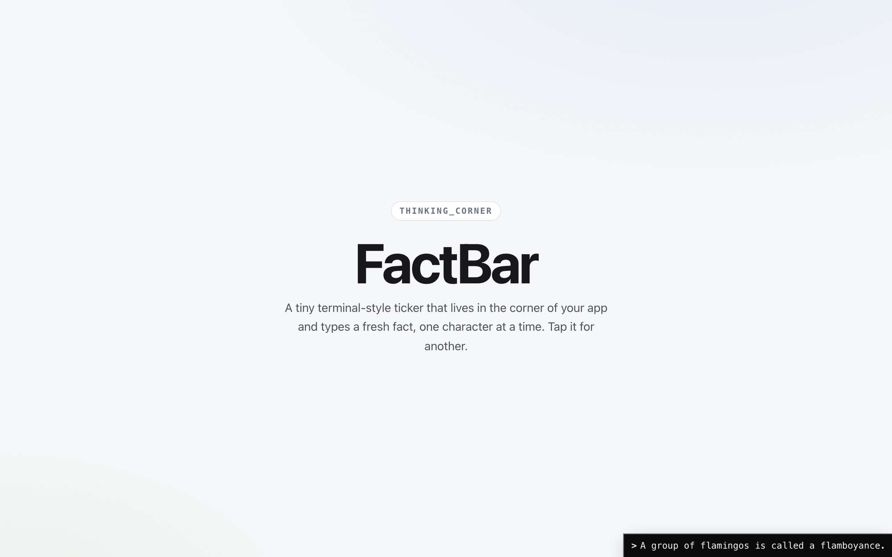

# thinking_corner

**FactBar** — a tiny terminal-style ticker that lives in the corner of your app
and types a fresh fact one character at a time. A spinner holds the corner
between facts, the old line slides off, and the next one rises and types in with
a little organic jitter.



## Highlights

- **Self-contained** — one component, inline styles, zero dependencies beyond React.
- **Terminal feel** — classic `| / - \` spinner while busy, a `>` prompt when idle.
- **Organic typing** — per-keystroke jitter and a beat after punctuation.
- **Plug in your own source** — point `API_URL` at any endpoint returning
  `{ fact: "..." }` (or a raw string); falls back to built-in mock facts.
- **Auto-rotates** every 8s, or tap the bar for another fact.

## Run the demo

```bash
npm install
npm run dev
```

Then open the printed local URL. The bar lands in the bottom-right corner.

## Use it in your app

Copy `src/FactBar.jsx` into your project and render it once near the root:

```jsx
import FactBar from "./FactBar";

export default function App() {
  return (
    <>
      {/* ...your app... */}
      <FactBar />
    </>
  );
}
```

To use a live source, set `API_URL` at the top of `FactBar.jsx`:

```js
const API_URL = "https://your.api/facts/random"; // returns { fact: "..." }
```

## Tuning

A few constants at the top of `FactBar.jsx` control the motion:

| Constant         | What it does                                  |
| ---------------- | --------------------------------------------- |
| `TYPE_MS`        | Base typing speed per character               |
| `JITTER_MS`      | ± random wobble per keystroke                 |
| `PUNCT_PAUSE_MS` | Extra pause after `. , ? ! ; :`               |
| `EXIT_MS`        | How long the old line takes to slide off      |
| `HOLD_MS`        | How long the lone spinner sits between facts  |
| `SPIN_MS`        | Spinner frame interval                        |

## License

MIT
